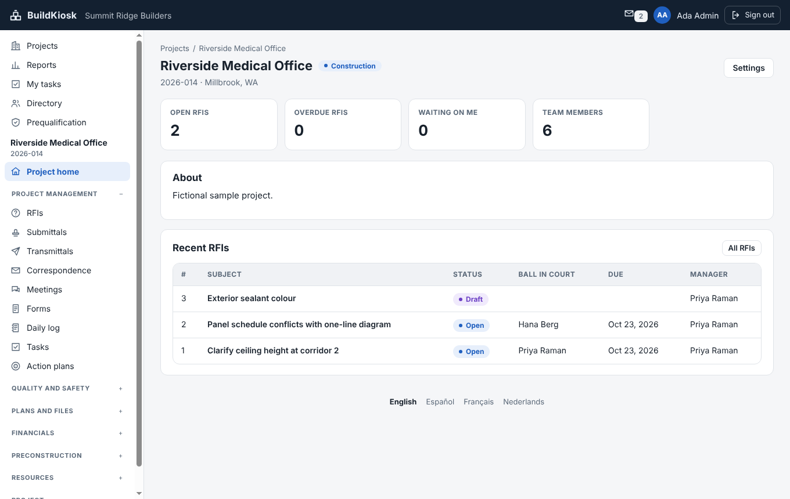
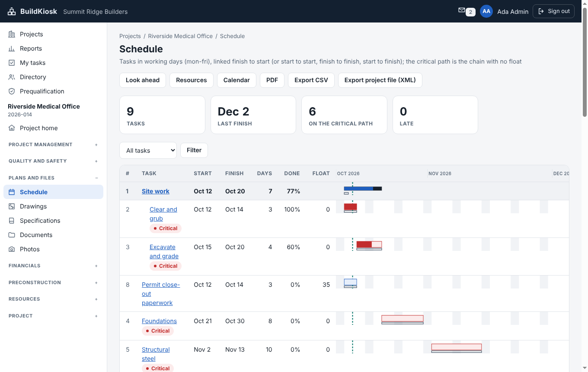
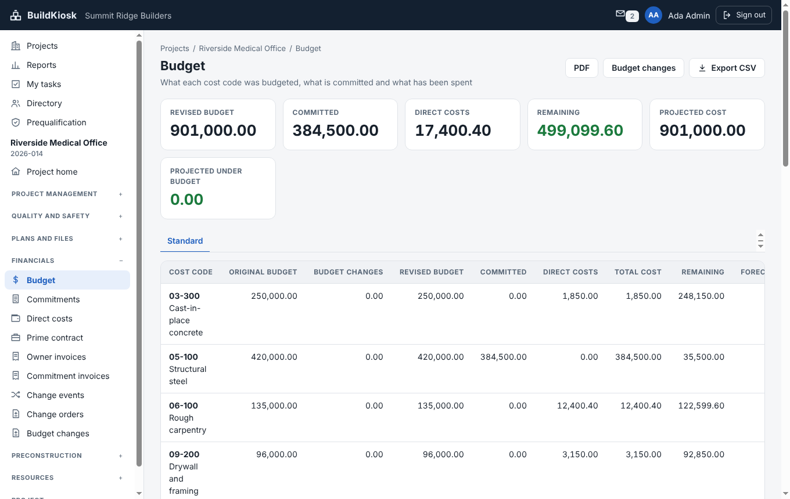
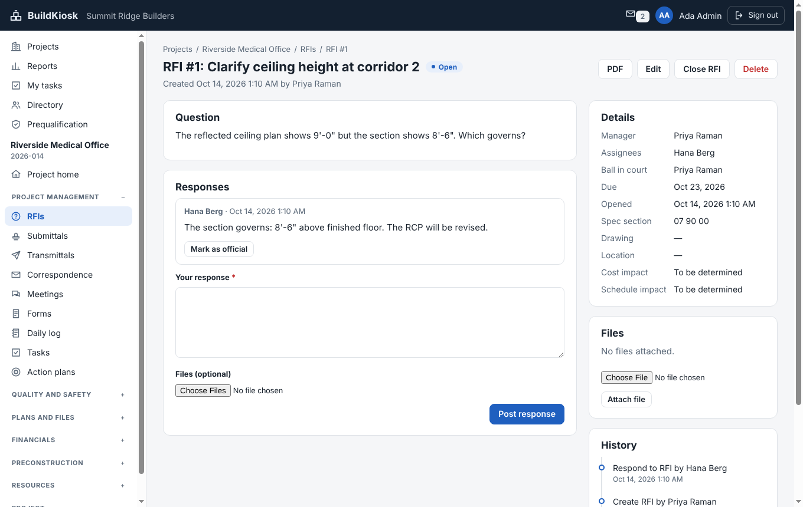
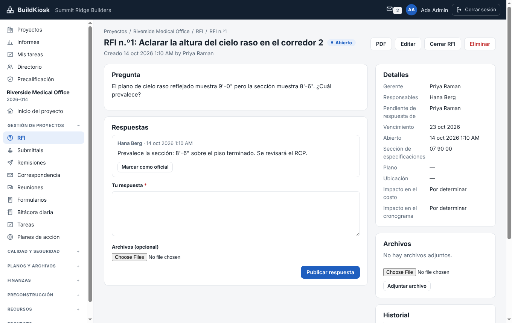

<h1 align="center">BuildKiosk</h1>

<p align="center">
  <b>Open-source construction management software: a clean-room Procore clone, written in Rust.</b>
</p>

<p align="center">
  RFIs, submittals, drawings, daily logs, punch lists, inspections, schedules, budgets, commitments, change
  orders, invoicing, estimating and bidding, in one self-hosted program with a web interface that needs no
  JavaScript, and an HTTP API, a command line and an MCP server so agents can do everything a person can.
</p>

<p align="center">
  
  
  
  
  
  
  
</p>

> [!NOTE]
> **Pre-release.** The tools below work end to end and are tested, but BuildKiosk has not been run on a real
> job site yet, release builds are published only once a version is tagged (until then, build it from source, below), and the translations have not been
> read by native speakers. Keep backups (`docs/deployment.md`), and judge each tool by the "Not yet" notes in
> [`docs/gaps.md`](docs/gaps.md), not by its name.

<p align="center">
  
  <br><sub>A project's home: every tool in the sidebar, grouped the way a general contractor works</sub>
</p>

## What it is

BuildKiosk covers the same ground as Procore: the project-management, quality, drawing, scheduling and
financial tools a general contractor, owner or subcontractor uses from preconstruction to closeout, under the
same plain tool names (RFIs, submittals, punch list, daily log). It is a **clone in purpose, not in code or
look**: it was written clean-room, from public documentation and the builder's own knowledge, with its own
wording, layouts and defaults, and without using Procore's software, code, text or data.

It runs as **one server binary** you host yourself, keeps each company's data in its own folder, and records every
change in an append-only journal. Pages are plain HTML with plain forms (the server sends
`script-src 'none'`), apart from the sheet viewer, which is Rust compiled to WebAssembly.

<table>
  <tr>
    <td width="50%"><br><sub>Schedule: critical path, float, baseline under each bar</sub></td>
    <td width="50%"><br><sub>Budget: by cost code, with committed and direct costs</sub></td>
  </tr>
  <tr>
    <td width="50%"><br><sub>An RFI: ball in court, responses, files and history</sub></td>
    <td width="50%"><br><sub>The same RFI in Spanish (also French and Dutch)</sub></td>
  </tr>
</table>

## The tools

Everything below is built, with engine rules, permissions, tests, pages and API access. The depth of each tool
differs; [`docs/gaps.md`](docs/gaps.md) lists what each one still lacks.

### Project management

| Tool | What you can do |
| --- | --- |
| **RFIs** | Ask, assign, answer and close; ball in court and due dates; a distribution list; an official response; files on the RFI and on each answer; change history; PDF and CSV; ageing in reports |
| **Submittals** | An ordered review workflow with revisions and responses; specification sections; register import and export; files on reviews; notifications |
| **Transmittals** | Send itemised sets of documents and drawing sheets with the version that went out; acknowledgements and a sign-and-return PDF cover sheet |
| **Correspondence** | Letter types numbered on their own; file incoming mail (or import an email); link to RFIs, documents and submittals; letter PDF |
| **Meetings** | Agendas, attendance, minutes, action items that become tasks and carry forward, series, templates, a sign-in sheet |
| **Forms** | Templates with conditional fields, signatures, schedules (daily to yearly) and reports |
| **Daily log** | Weather, manpower, equipment, deliveries, visitors and notes; draft, submit and reopen; weekly summary; copy yesterday's crews |
| **Tasks** | Subtasks, repeating rules (daily to yearly, month-end), a calendar and "my tasks" across projects |
| **Action plans** | Sectioned checklists with owners, dates, approvers, comments, templates and a PDF |

### Quality and safety

| Tool | What you can do |
| --- | --- |
| **Punch list** | Items with assignees and a review loop; bulk import; PDFs for site walks |
| **Observations** | Categories per project, trends over six months, the same review loop |
| **Inspections** | Checklist templates with scoring and section scores, repeating inspections, signatures, punch items raised from failed lines, PDF |
| **Incidents** | Severity, root cause and corrective action; private incidents; injury logs with recordable and lost-time rates, per project and for the company |

### Plans and files

| Tool | What you can do |
| --- | --- |
| **Drawings** | A sheet log with revisions and sets; an in-browser viewer with pan, zoom, markups and revision compare; set a scale and measure lengths, areas, paths and outlines and count items; a quantities report by cost code; send take-offs to an estimate |
| **Specifications** | Sections with links from RFIs and submittals |
| **Documents** | Folders and versions, files restricted to named people, previews, zip downloads, a recycle bin |
| **Photos** | Albums and tags, thumbnails that respect camera orientation, a slideshow, side-by-side compare |
| **Schedule** | A Gantt chart with critical path and float; working calendars and company holiday lists; seven kinds of constraint; named baselines; look-ahead; resource loading and levelling against limits; drag bars to move work; import Microsoft Project XML (with resources, limits and the calendar if you want them) and Primavera exchange (.xer) files |

### Financials

| Tool | What you can do |
| --- | --- |
| **Budget** | By cost code with forecast, saved views, snapshots and comparison, and a lock; PDF and CSV |
| **Commitments** | Subcontracts and purchase orders with schedule of values, change orders, approvals, signatures (the other party can sign through an emailed link) and files |
| **Direct costs** | Costs outside commitments, posted to the budget |
| **Prime contract** | The owner's contract, its change orders, and owner invoices (payment applications designed from first principles) |
| **Commitment invoices** | Invoices against commitments with retainage |
| **Change events and orders** | From a possible change to approved change orders on both the prime contract and commitments; budget changes |

### Preconstruction, resources and company

| Tool | What you can do |
| --- | --- |
| **Estimating** | A priced catalogue with price history by supplier, assemblies, take-offs from drawings, estimates with markups, alternates and versions, templates, and "put it in the budget" |
| **Bidding** | Bid packages with scope, addenda and acknowledgements, leveling, weighted scoring, bid bonds, and award to a commitment; a bidder portal where invited companies, with no account, open an emailed link to read the documents, ask questions, attach files, and send, change or withdraw a sealed bid, an open link for public work where companies ask to be invited, and emails and notices at each step |
| **Timesheets** | Hours with overtime rules, pay rates, crews and a labour cost report that posts to the budget |
| **Prequalification** | Scored, versioned questionnaires that companies can answer themselves through an emailed link (no account), insurance and licence expiry warnings to the admins and the company, standing shown on commitments, and an optional rule that awards need a current prequalification |
| **Reports** | Per-project and company reports with chosen columns across the tools, totals, bar, column and pie charts, CSV and PDF; saved reports can be emailed on a schedule to chosen people, each seeing only what they may see |
| **Directory and permissions** | Companies and people, permission templates, and per-tool overrides on each team member; every rule is enforced in the engine |

### For agents and administrators

- **Everything is a command** (about 500 of them). The web pages, the HTTP API (`POST /api/v1/commands/{id}`),
  the command line (`buildkiosk run`) and the **MCP server** all reach the same registry, so an agent can do
  anything a person can, with the same permissions. MCP also serves documents, drawings and photos as resources
  (with change notifications) and ready-made prompts.
- **An append-only journal** is the source of truth: every change records who did what, when and which rows
  moved, and any company's state can be rebuilt by replaying it.
- **Backups** while the server runs, a second folder, or S3-compatible object storage; restore a whole data
  folder or one company.
- **The interface speaks English, Spanish, French and Dutch**, chosen at the foot of every page.
- Security basics: argon2id passwords, `HttpOnly` same-site cookies, a CSRF token on every form, rate-limited
  sign-in, size limits and attachment-only downloads.

### Not yet

A way to share documents by link, offline field mode and mobile apps, native
Microsoft Project (.mpp) files, integrations with other software, and the
long tail of each tool. These are tracked in [`docs/gaps.md`](docs/gaps.md) and [`ROADMAP.md`](ROADMAP.md).

## Install or build it

A released version installs with one command (Linux and macOS; Windows has a .zip on the releases page). It checks the
download against published checksums first, and `--help` lists the options (see [`docs/deployment.md`](docs/deployment.md)):

```sh
curl -fsSL https://raw.githubusercontent.com/SiteSentrix/buildkiosk/main/install.sh | sh
```

The Windows and macOS programs are signed (Windows: Authenticode; macOS: Developer ID, notarized by Apple), so the system does
not warn about an unknown publisher. To check a signature, on Windows `Get-AuthenticodeSignature .\buildkiosk.exe`, on macOS
`codesign --verify --strict --check-notarization buildkiosk` (see [Signed builds](docs/deployment.md#signed-builds)). Linux
programs are not signed; the checksums and build attestations cover every archive.

Or run the container image (Linux x86_64 and aarch64; the data lives in the `/data` volume, and Compose and proxy notes are in
[`docs/deployment.md`](docs/deployment.md)):

```sh
docker run -d --init -p 127.0.0.1:8080:8080 -v buildkiosk-data:/data ghcr.io/sitesentrix/buildkiosk:<version>
```

To build it yourself you need Rust 1.97 or newer.

```sh
cargo run -p buildkiosk -- demo --data ./demo-data                                   # a fictional company
cargo run -p buildkiosk -- serve --data ./demo-data --bind 127.0.0.1:8080            # then open http://127.0.0.1:8080
cargo run -p buildkiosk -- commands                                                 # every command, with its parameters
cargo run -p buildkiosk -- mcp --data ./demo-data --company summit-ridge --as ada@example.com   # MCP over standard input
cargo xtask ci                                                                       # fmt, clippy, tests, licences, layering, wasm
```

The demo prints the sign-in details (all names are fictional). For real use, see
[`docs/deployment.md`](docs/deployment.md): HTTPS, backups, upgrades and restores.

## Documentation

- [`docs/architecture.md`](docs/architecture.md), [`docs/development.md`](docs/development.md): how it is built, and how to work on it
- [`docs/api.md`](docs/api.md): the HTTP API, the command line and the MCP server
- [`docs/deployment.md`](docs/deployment.md): running it for real, HTTPS, backups, object storage, restores
- [`ROADMAP.md`](ROADMAP.md) and [`docs/gaps.md`](docs/gaps.md): what exists and what is missing, tool by tool
- [`AGENTS.md`](AGENTS.md): the rules every contributor and agent follows (clean-room, no panics, no JavaScript,
  everything is a command)
- [`CONTRIBUTING.md`](CONTRIBUTING.md) and [`SECURITY.md`](SECURITY.md): how to contribute, and how to report a vulnerability

## Clean-room, licence and credits

BuildKiosk is written clean-room: behaviour comes only from public documentation, written in its own words, and
nothing is copied from Procore's software, text, data, icons or layouts. Procore is a trademark of Procore
Technologies, Inc., named here only to say what kind of software BuildKiosk is. BuildKiosk is an independent
project, not made, sponsored or endorsed by Procore. The rules are in [`AGENTS.md`](AGENTS.md).

Dual-licensed under [MIT](LICENSE-MIT) or [Apache-2.0](LICENSE-APACHE), at your option. Required notices are in
[NOTICE](NOTICE); every image in this repository is listed with its author, source and licence in
[ASSETS.md](ASSETS.md). The screenshots are of the app showing its fictional demo company. The name and logo
belong to the project owner.
